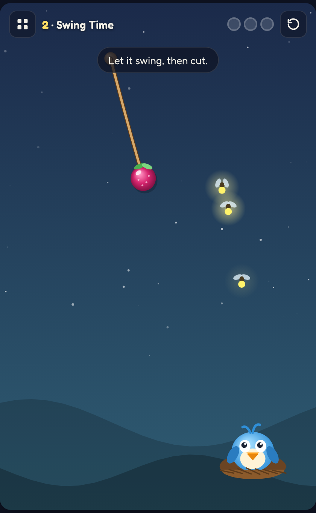
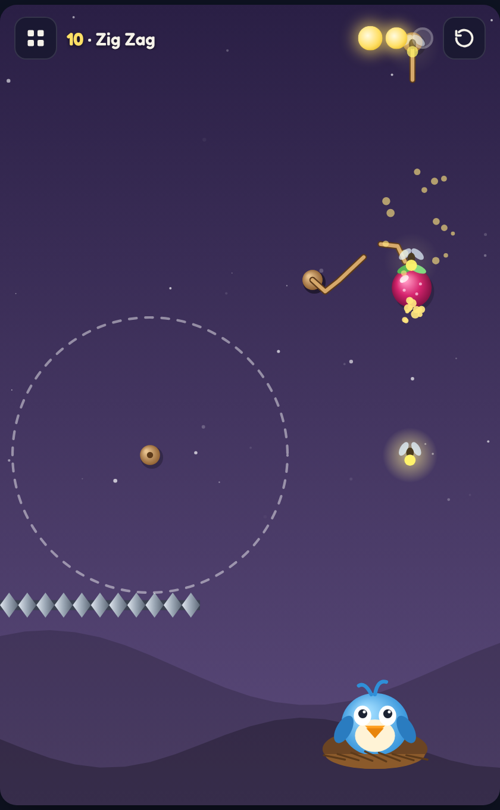
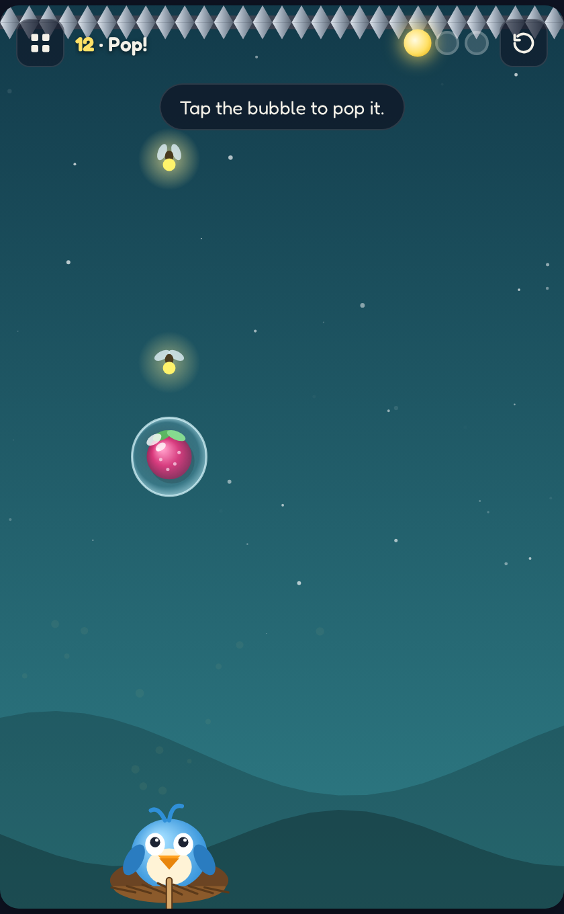

# Snip & Drop

A rope-cutting physics puzzle game. Pip the baby bird is hungry: cut the ropes so the berry swings, floats and gets puffed into the nest, and grab the 3 fireflies along the way.

**24 levels** across 5 chapters: Ropes, Pegs, Bubbles, Air Puffs and Everything.

## Play

Open `index.html` in a browser. No build step, no install.

- **Swipe** across a rope to cut it
- **Tap** the berry while it's in a bubble to pop it
- **Tap** a blower to puff air at the berry
- Dashed circles are pegs that grab the berry with a new rope when it flies close
- Spikes and falling off the screen lose the level
- Press **R** to restart

Progress (fireflies per level) is saved in your browser. Each level unlocks after you beat the one before it.

## Files

- `index.html`: page, styles, menus
- `js/engine.js`: physics (ropes, bubbles, blowers, spikes). Has no DOM code, so it runs in Node too
- `js/game.js`: drawing, input, sound, screens
- `js/levels.js`: generated level data (don't edit by hand)
- `tools/levels-src.js`: level layouts. Edit this to add or change levels
- `tools/build-levels.js`: finds a working solution for every level, places the fireflies on it, and writes `js/levels.js`
- `tools/robust.js`: checks how much slack each level's timing has
- `tools/shots.js`: takes screenshots into `docs/` (needs Playwright)

To add a level, add an entry to `tools/levels-src.js` and run:

```bash
node tools/build-levels.js
```

It fails if any level can't be won with all 3 fireflies.

## Screenshots

| | | |
|---|---|---|
|  |  |  |
|  |  |  |
